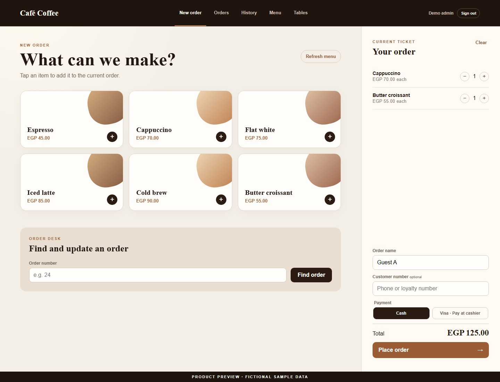
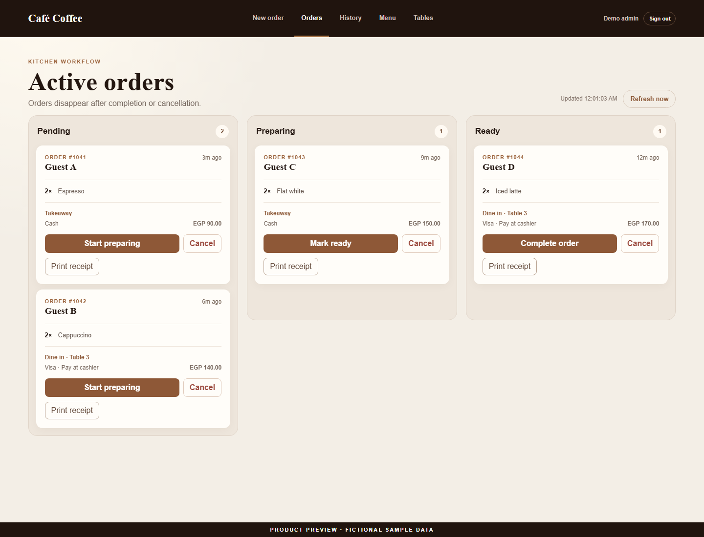
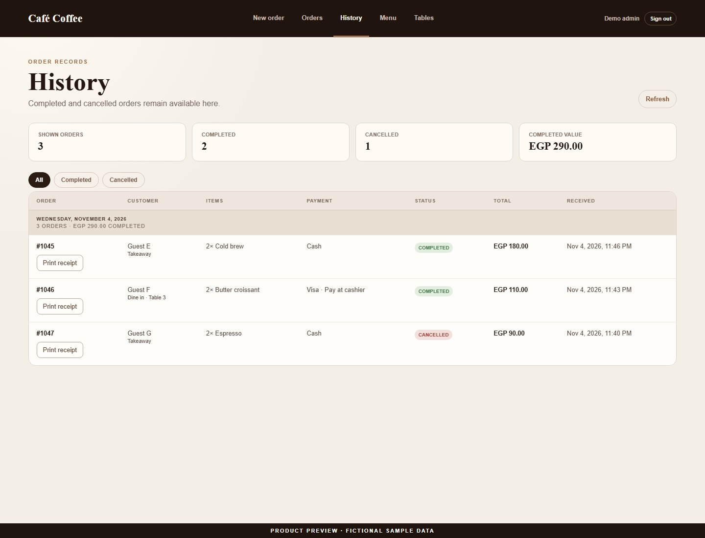
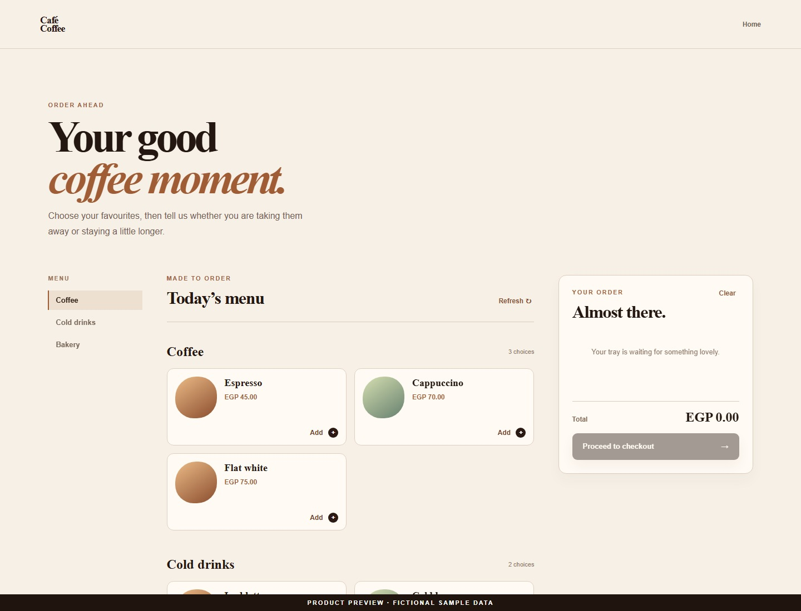
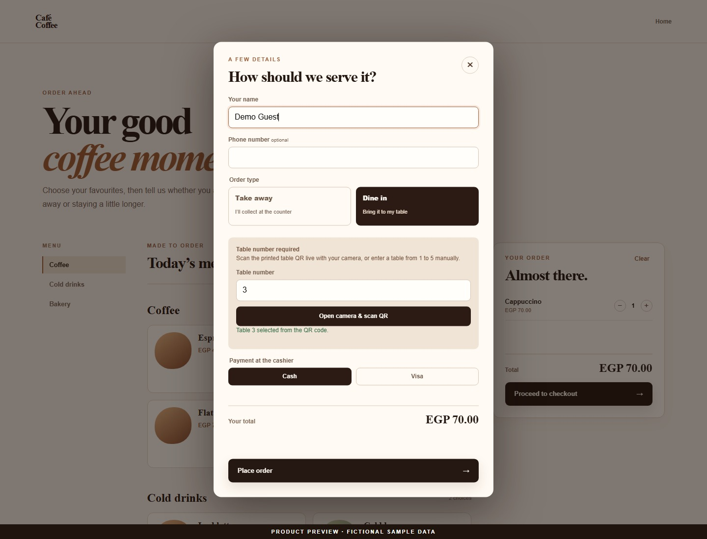
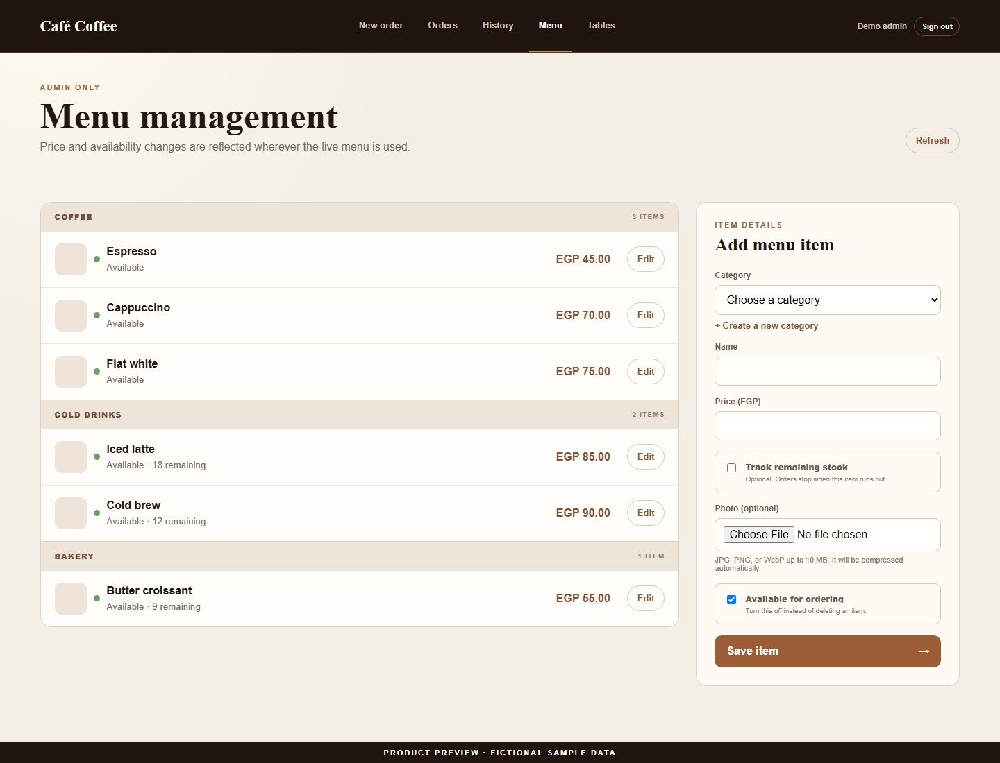
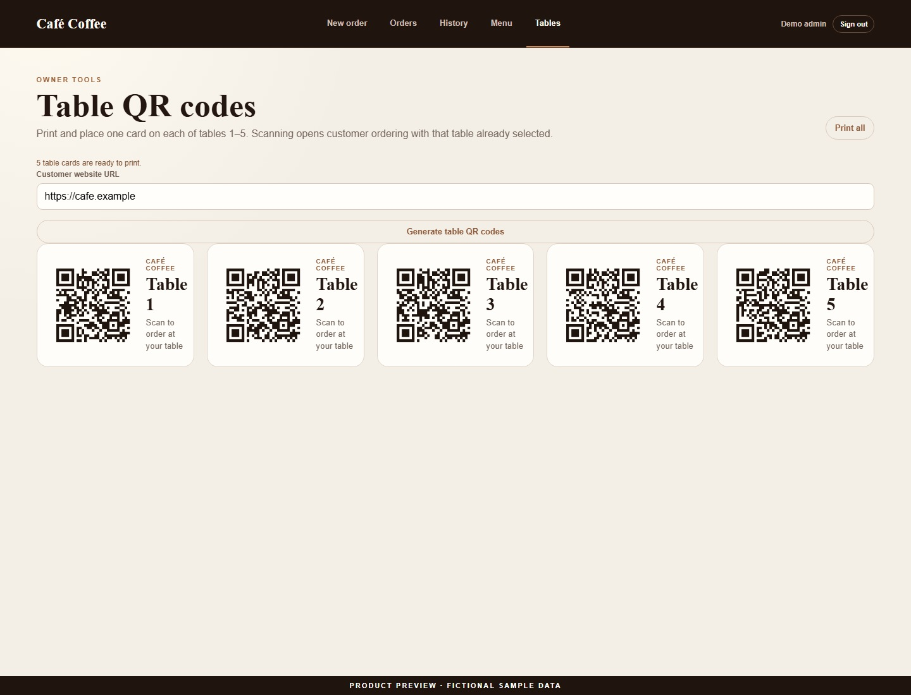
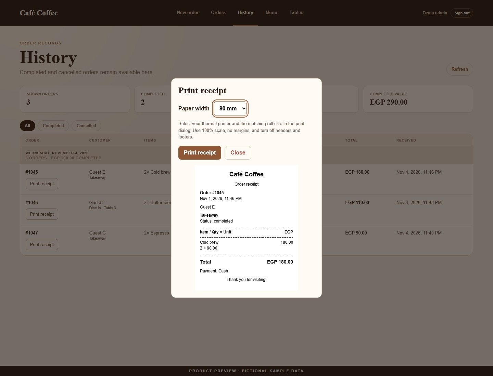
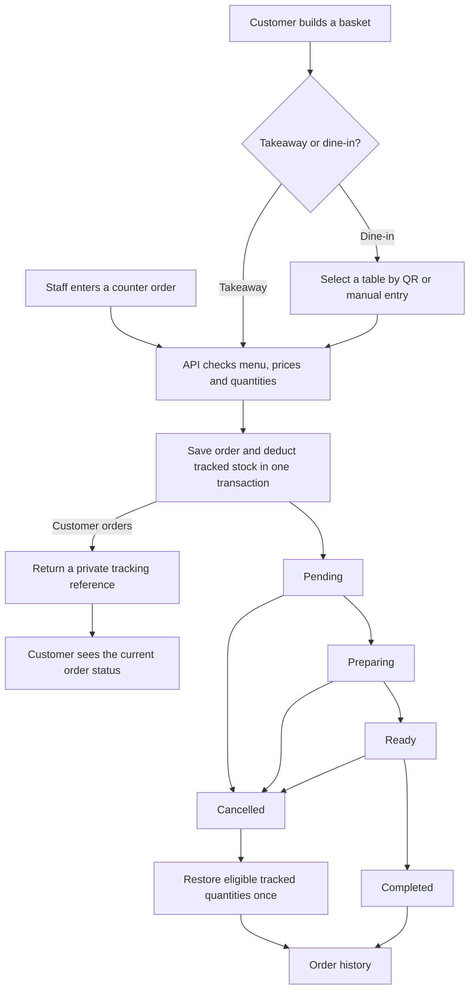
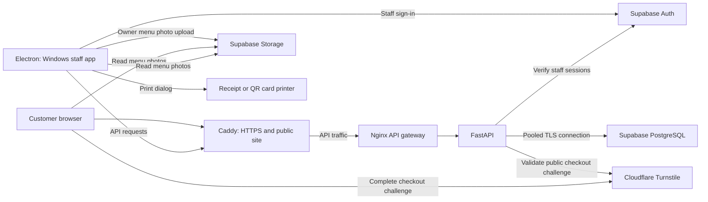

# Valore Coffee | Café ordering and operations

**A Windows point of sale and a customer ordering site that share one menu, one kitchen queue, and one order history.**

Counter staff can enter walk-in orders while customers order from their phones. Both paths feed the same kitchen board, so staff see what to make, where it goes, and how the customer intends to pay. The owner can change prices, mark items unavailable, track stock where it matters, and print QR cards for five tables.

`JavaScript / Vite` · `Electron` · `Python / FastAPI` · `Supabase / PostgreSQL` · `Docker Compose`

**Project status:** This is a portfolio case study with fictional-data screenshots. The database is currently unavailable. The application source is maintained separately.

[Screenshots](#screenshots) · [Product workflow](#product-workflow) · [Architecture and integrations](#architecture-and-integrations) · [Engineering decisions](#engineering-decisions) · [Development and verification](#development-and-verification) · [Release status](#release-status)

## Screenshots

The captures use the application UI with fictional menu items and orders under the demo name Café Coffee. The staff captures show the screens used inside the Windows app. The printed table cards in the preview use a sample URL. Select an image to open it at full size.

### Staff and kitchen

**Counter order desk:** Item selection, a running ticket, payment choice, and lookup by order number.

| Kitchen board | Order history |
| :---: | :---: |
|  |  |

### Customer website

| Café homepage | Customer menu |
| :---: | :---: |
|  |  |

**Dine-in checkout:** Table 3 is selected. The customer can use the camera or enter a table manually, then select cash or Visa at the cashier.

### Owner tools and receipts

| Menu and stock | Table QR cards |
| :---: | :---: |
|  |  |

**Thermal receipt preview:** The staff app can reprint a saved order with the prices recorded at checkout.

## Product workflow

1. **Take the order.** Staff sign in and build a ticket from the counter menu. Customers browse the public menu without signing in, review their basket, and choose takeaway or dine-in. A printed QR link preselects the table; the in-page scanner and manual entry are alternatives. An optional phone number or counter reference helps staff identify an order. Cash and Visa are payment instructions for the cashier; the app does not collect card details or process payments.
2. **Save the order.** The API checks the request and current menu, calculates the total, and saves the order and its line items. If stock tracking is enabled for an item, checkout deducts its quantity in the same transaction. A successful customer checkout returns an order number and a private reference for status tracking.
3. **Prepare and hand it off.** The kitchen board refreshes automatically. Staff advance an order from pending to preparing to ready, then complete it when it is handed off. The customer can follow that status after a page refresh. Staff can cancel an order from any active state; eligible tracked stock is returned once.
4. **Review the shift and maintain the menu.** Completed and cancelled orders move out of the active queue into history, which groups orders by day and totals completed order value. Staff can print a receipt after checkout or reprint from lookup, the board, or history. Owners manage categories, prices, availability, photos, stock, and the five table cards from the staff app.

## Architecture and integrations

| Layer | What it does |
| --- | --- |
| Customer website | Responsive HTML, CSS and JavaScript built with Vite. The public build contains the café homepage and ordering page. Checkout supports table selection, an expandable mobile basket, and order tracking that pauses when the page is hidden and stops at a final status. |
| Windows staff app | Electron packages the staff interface separately as a portable Windows app. It needs a connection to the API and Supabase. The renderer is sandboxed with context isolation and no Node integration. The staff build has a dedicated login, point of sale, kitchen board, history, menu editor, and table tools. |
| API and identity | FastAPI validates order and menu requests. Supabase Auth provides staff sessions; the API verifies the bearer token and reads the role from trusted account metadata. Staff can take and manage orders. Menu administration requires the admin role. |
| Data and images | Supabase PostgreSQL stores categories, items, orders and order lines. The API uses a bounded connection pool, TLS, and a restricted database login. Row-level security and restricted grants limit direct access. Supabase Storage holds menu photos; the browser compresses images before upload. |
| Table cards and printing | The owner tool generates printable QR cards for tables 1–5 from the customer website URL. Customers can open the link with the phone camera or scan inside checkout without uploading an image. The separate thermal receipt preview supports 80 mm and 58 mm rolls through the operating system print dialog. |
| Deployment and abuse controls | The prepared Docker Compose stack uses Caddy for HTTPS and an internal Nginx gateway for same-origin API routing, request size limits and shared per-IP throttling across its workers. FastAPI applies its own route limits. Cloudflare Turnstile is checked server-side for production customer checkout. |

The diagram shows the prepared hosting topology. Earlier checks exercised the API locally and used the configured Supabase database for migration and smoke checks.

## Engineering decisions

- **Use saved prices for the order.** The client displays a running total; the server validates availability and calculates the amount from the menu at checkout. Order lines keep their unit prices, so a later price change does not alter history or receipt totals.
- **Make retries safe.** Both order screens prevent overlapping submissions. If a response is lost, retrying the same submission key returns the original order and price. Sending changed contents under that same key is rejected. Staff keys are scoped to the signed-in user and kept separate from public checkout keys.
- **Keep stock consistent when requests overlap.** Tracking is optional per item. Checkout groups duplicate item lines and locks item rows in a consistent order before validating and deducting stock. A failed order rolls back the deduction. Sold-out items disappear from the ordering menus. Cancellation restores only quantities the order actually deducted, while tracking is still enabled; older orders without that record are excluded. Staff may need to adjust stock manually if a prepared item cannot be resold.
- **Limit what a customer can look up.** The order number alone cannot retrieve status. The customer sends a private tracking reference in a request header and receives only the status details needed for pickup or table service. Staff lookup and history require authentication.
- **Keep routine refreshes out of the way.** The kitchen board polls because staff need the queue to stay current. The customer menu loads once and refreshes on request, so it does not redraw while someone builds a basket. If refreshed availability makes an item unavailable, the basket removes it and tells the customer.
- **Keep printing separate from payment and fulfillment.** Printing an order uses its saved details and does not mark it paid or change its kitchen status. The printer driver controls roll handling and cutting; the preview is independent of those hardware settings.

## Development and verification

The working checkout uses a Vite dev server and a local FastAPI instance. Frontend tests run through Node; backend tests use pytest. Database tests use disposable PostgreSQL, and signed-in browser QA used a local Auth fixture. Public web and Windows staff builds are produced separately. Schema changes run through a database owner connection; the application's restricted login is used for runtime checks.

| Stage | Work and evidence |
| --- | --- |
| Counter and kitchen | Built the POS, order lookup, automatically refreshed kitchen board, and date-grouped history. Added staff/admin authorization and the owner menu editor with optional photos. Browser QA covered staff and admin sign-in, invalid-password feedback, logout, staff denial from admin pages, menu edits, order submission and kitchen transitions. |
| Customer ordering and table service | Added category browsing, checkout, tracking, and table cards. Tested takeaway and dine-in orders, tracking after reload, and starting another order. The migration was tested against clean and older schemas before being applied to Supabase. New orders were restricted to tables 1–5 without rewriting older records outside that range. |
| Responsive and deployment QA | Checked public layouts from 320 to 1440 px and staff screens at narrow, tablet, and desktop widths. Validated the Docker Compose, Caddy and Nginx configurations and exercised oversized request rejection and rate limiting on the local proxy. |
| Transaction and concurrency checks | Exercised replay, changed-payload conflicts, authorization boundaries, tracking references, and rollback on a failed line insert. A local HTTP smoke run completed 100 simultaneous staff workflows, including sign-in and retry, with exactly 100 distinct orders. This measured fixture services on one machine. |
| Stock and cancellation | Added optional per-item stock, tested last-unit contention and duplicate retries, then added cancellation restocking. The stock and restock migrations were applied to the configured Supabase database at the time. The last recorded stock/restock pass ran 33 PostgreSQL integration checks, including concurrent cancellation and legacy/untracked cases. |
| Windows packaging and receipts | Built the portable Windows staff app before the receipt work. The current frontend suite passes all 28 checks, including saved receipt prices and escaping user-supplied text. The receipt feature requires a new Windows package before use on staff PCs. |

## Release status

| Area | Current state |
| --- | --- |
| Portfolio | The public repository contains this walkthrough, diagrams, and fictional-data product captures. |
| Database and live ordering | The database is currently unavailable. Earlier migration and local QA results describe the environments tested at the time; live order placement is not available for this showcase. |
| Public launch | The deployment configuration is prepared and was validated locally. A live domain, certificate issuance, and real Turnstile checkout still need end-to-end verification. Final café contact details also need confirmation. |
| Device and operations checks | Verify a printed table QR on a physical phone, receipt alignment and cutting on the intended printer, real Auth and Storage flows, backup recovery, and realistic traffic through the chosen host and shared café Wi-Fi. |
